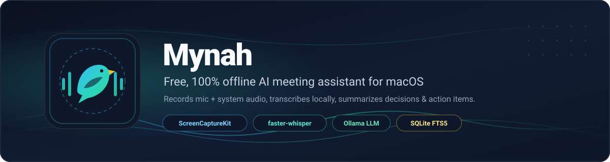
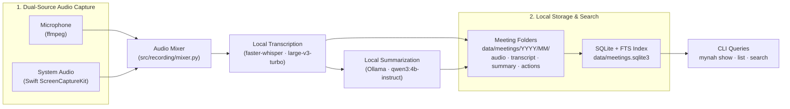

<p align="center">
  
</p>

<p align="center">
  
  
  
  
  
  <a href="LICENSE"></a>
</p>

<p align="center">
  <a href="#what-it-actually-does">What It Does</a> •
  <a href="#architecture">Architecture</a> •
  <a href="#why-offline-matters">Why Offline</a> •
  <a href="#easy-installation-guide">Install</a> •
  <a href="#how-to-use-it">Usage</a> •
  <a href="#configuration">Configuration</a> •
  <a href="#where-your-data-lives">Data &amp; Privacy</a> •
  <a href="#development">Development</a>
</p>

---

Mynah records your meetings, writes down what was said, and gives you a short summary with the decisions and action items — all on your own computer. No cloud, no subscription, no meeting bot joining your call, no sending your conversations to anyone else's servers.

A mynah bird listens and repeats back what it hears. That's exactly what this tool does for your meetings.

## What it actually does

1. You run one command before your meeting starts.
2. It records **both** your microphone and your computer's speaker output at the same time — so it hears you *and* everyone else on the call, even if they're joining through Zoom, Meet, Teams, or a phone speaker.
3. You run one command when the meeting ends.
4. A minute or two later, you have:
   - A full **transcript** of everything that was said, with timestamps
   - A short **summary** of what the meeting was about
   - The **decisions** that were made
   - The **action items**, with who owns them and when they're due, if that came up
   - Any **risks** or **open questions** that were raised

Everything is saved as plain text files on your computer, and you can search across all your past meetings by keyword.

## Architecture



## Why offline matters

Most meeting note-taking tools send your audio to a company's servers to transcribe and summarize it. Mynah doesn't. It runs a speech-to-text model and a small local language model directly on your Mac, using open-source tools ([faster-whisper](https://github.com/SYSTRAN/faster-whisper) and [Ollama](https://ollama.com)). Nothing about your meeting ever leaves your machine.

This also means it keeps working without an internet connection, and it costs nothing to run — no per-minute transcription fees, no monthly subscription.

## Easy installation guide

You'll need a Mac. Open the **Terminal** app, go into this project folder, and run:

```bash
./install.sh
```

This sets everything up for you — no other steps needed. When it's done, close the Terminal window, open a new one, and you're ready to go.

The first time you record, macOS will ask you to grant Screen Recording permission (this is how Mynah is able to hear the other people in your meeting, not just your own microphone) — just click **Allow**.

<details>
<summary>Manual installation (if you'd rather run each step yourself)</summary>

You'll need a few free programs installed. If you don't have these yet:

```bash
brew install ffmpeg ollama uv
ollama pull qwen3:4b-instruct
```

Then, from inside this project folder:

```bash
uv venv --python 3.12
uv pip install -r requirements.txt -r requirements-dev.txt
swiftc tools/system_audio_recorder/main.swift -o tools/system_audio_recorder/system_audio_recorder \
  -framework ScreenCaptureKit -framework AVFAudio -framework CoreMedia
```

The last command builds the small helper that lets Mynah listen to your speaker output — it only needs to be built once.

If you'd like to run `mynah` from anywhere instead of typing the full path every time, link it into a folder that's on your PATH:

```bash
ln -s "$(pwd)/run.py" ~/.local/bin/mynah
```

</details>

## How to use it

Start recording:

```bash
mynah record
mynah record --title "Weekly Sync"   # optional custom title
```

When the meeting's done, stop it — this single command does the transcription, summary, and saving automatically, no other steps needed:

```bash
mynah stop
```

See your notes:

```bash
mynah show
```

This shows your most recent meeting and asks whether you want the summary or the full transcript.

Other things you can do:

```bash
mynah list                                # see all your past meetings
mynah search "budget"                     # find every meeting that mentioned "budget"
mynah show meeting-003 --section summary  # jump straight to a specific meeting's summary
mynah process some-recording.wav          # summarize a WAV audio file you already have
```

## Configuration

Defaults are defined in [`src/config/settings.py`](src/config/settings.py) and can be overridden via environment variables:

| Variable | Default | Purpose |
| --- | --- | --- |
| `WHISPER_MODEL_SIZE` | `large-v3-turbo` | `faster-whisper` model used for transcription |
| `OLLAMA_MODEL` | `qwen3:4b-instruct` | Local Ollama model used for summarization |
| `MEETINGS_ROOT` | `data/meetings` | Root folder for saved meeting artifacts |
| `DB_PATH` | `data/meetings.sqlite3` | SQLite metadata & full-text search index |
| `RECORDING_STATE_PATH` | `data/recording_state.json` | Active background recording PID/state file |
| `SYSTEM_AUDIO_RECORDER_BINARY` | `tools/system_audio_recorder/system_audio_recorder` | Compiled Swift ScreenCaptureKit helper |

## Where your data lives

Everything is saved under `data/meetings/`, organized by year and month. Each meeting gets its own folder with the transcript (`transcript.md`), summary (`summary.md`), action items (`actions.md`), metadata, and the original audio — all as plain files you can open, back up, or delete whenever you want. Nothing is uploaded anywhere.

## Development

| Path | Role |
| --- | --- |
| [`run.py`](run.py) & [`src/cli.py`](src/cli.py) | CLI entrypoint (`record`, `stop`, `process`, `list`, `search`, `show`) |
| [`src/recording/`](src/recording/) | Multi-source background recorder, `ffmpeg` mic capture, and audio mixer |
| [`tools/system_audio_recorder/main.swift`](tools/system_audio_recorder/main.swift) | macOS `ScreenCaptureKit` system audio capture binary |
| [`src/transcription/`](src/transcription/) | `faster-whisper` transcription and Markdown formatter |
| [`src/summarization/`](src/summarization/) | Ollama subprocess client, parser, and summary/actions renderers |
| [`src/storage/`](src/storage/) & [`src/kb/`](src/kb/) & [`src/search/`](src/search/) | Meeting folder store, SQLite knowledge base, and keyword search |
| [`tests/`](tests/) | Unit and end-to-end test suite |

Run the test suite with:

```bash
pytest
```

## Good to know

- Mynah is built for one-on-one calls and team meetings where multiple people are speaking. It doesn't yet tell you *who* said what — everyone shows up as "Speaker 1" in the transcript for now.
- The first recording after installing will take a little longer, since it needs to download the speech-to-text model once. After that, everything runs fast and fully offline.

## License

Released under the [MIT License](LICENSE).
